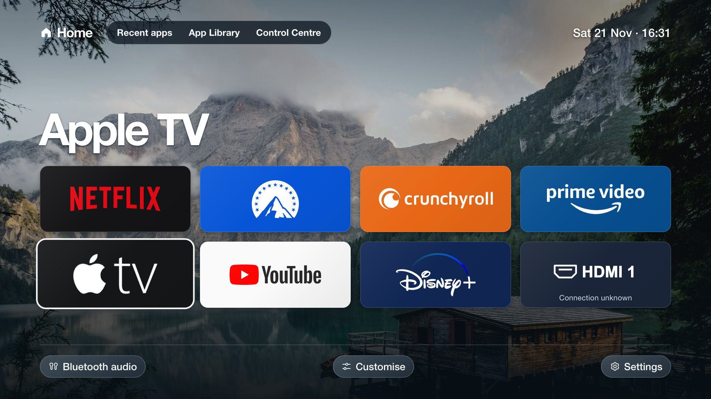

# Samsung TV Dashboard

A remote-first launcher for Samsung TVs. Open an installed streaming app, switch to a console on HDMI 1, or find a favourite in the app library. Built with HTML, CSS and JavaScript and tested on the 2017 Samsung UE43MU6100 with Tizen 3.0.



## Try it on a computer

Open `app/index.html` in a browser. Use the arrow keys to move, **Enter** to select and **Esc** to go back. The browser preview includes the Home screen, customisation and a sample app library. On a Samsung TV, the library reads the installed apps and the tiles open them.

## Using the remote

| To | Use |
| --- | --- |
| Open a streaming app | Press **OK** on its tile. Dashboard sends the launch request as soon as the button goes down. |
| Find an app | Press **Up** from the top row, open **App Library**, then press **Up** from its first row to search. |
| Return to a recent app | Open **Recent apps** above the grid. It remembers the last eight apps and inputs opened through Dashboard. |
| Set up your favourite apps | Open **Customise → Set up Home apps**, choose a shortcut, then pick an installed app. Repeat for any other shortcuts and press **Back** when finished. |
| Replace, move or hide a tile | Open **Customise → Tile options** and select the tile. The yellow remote key opens the highlighted tile’s options with the default shortcuts. |
| Use hold-to-edit | Turn off **Settings → Launch apps on OK press**. A tap then opens the app on release and a long press opens tile options. |
| Switch to a console | Select **HDMI 1** to show the connected device. Press **Back** to return. |
| Connect wireless headphones or a speaker | Open **Bluetooth audio** to reach the TV’s speaker list or model-specific guidance. |
| Adjust the viewing experience | Open **Control Centre** for audio, Reduce Motion or the landscape screen saver. |

## Install on a TV

1. Install Tizen Studio on a Mac with the Samsung TV and Samsung Certificate extensions. In Certificate Manager, create a Samsung TV signing profile that includes your TV. Keep the same author certificate for later updates. [Samsung certificate guide](https://developer.samsung.com/smarttv/develop/getting-started/setting-up-sdk/creating-certificates.html)
2. On the MU6100, open **Smart Hub → Apps**, enter **1 2 3 4 5**, enable **Developer Mode** and enter the Mac’s local IP address. Restart the TV and connect both devices to the same network. [Samsung device setup](https://developer.samsung.com/smarttv/develop/getting-started/using-sdk/tv-device.html)
3. Run the commands below from the project directory. Enter the **TV’s** IP address when the installer prompts you.

```sh
./Build.command
./Install.command
```

The build scripts use `~/tizen-studio` and a profile named `TV-Dashboard`. Set `TIZEN_SDK` or `TIZEN_PROFILE` in your shell to use a different installation or profile.

## Startup and app loading

On the MU6100, **Settings → General → Smart Features → Autorun Last App** can reopen Dashboard when it was the last app used. Turn off **Autorun Smart Hub** to hide the startup bar. [Samsung startup settings](https://www.samsung.com/uk/support/tv-audio-video/how-to-turn-the-samsung-home-bar-on-or-off/)

Dashboard sends the launch request and keeps the screen covered until the TV switches apps. Each streaming app loads its own interface. On supported models including the 2017 MU6100 group, Samsung can preload eligible apps from the left side of the **Smart Hub Home** row at power-on. Available memory limits how many it can keep ready. [Samsung prelaunch guide](https://developer.samsung.com/smarttv/develop/guides/fundamentals/prelaunching-applications.html) · [TV model groups](https://developer.samsung.com/smarttv/develop/specifications/tv-model-groups.html)

## Optional weather

To show local conditions in the screen saver, create `weather.local.js` beside `Build.command` and rebuild. For example, a build for London could use the following.

```js
window.dashboardWeatherLocation = { name: 'London', latitude: 51.51, longitude: -0.13 };
```

Git ignores this file. When ambient weather is enabled, Dashboard requests conditions from Open-Meteo for the configured location.
