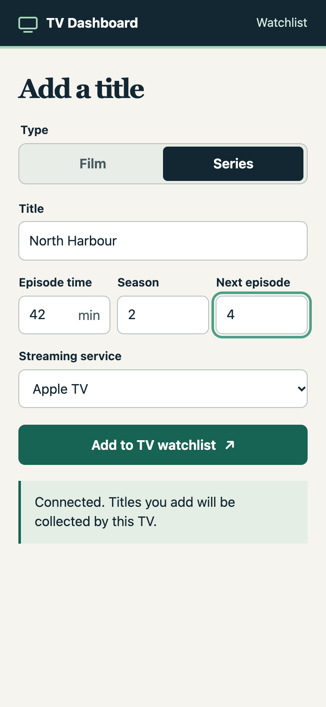

# Watchlist Companion

Pair an iPhone or another phone with the Dashboard and add films or series over home Wi-Fi. The Mac serves the pairing page and generates its QR code locally with Apple's Core Image. No internet account or catalogue is required.



## Install on the Mac

From this directory, run `python3 install.py` while logged in. This requires macOS, Python 3.9 or later and the Xcode Command Line Tools. The installer prints the address to enter on the TV. The user LaunchAgent starts at login and restarts with a new LAN address after a network change. Reserve the Mac's local IPv4 address on the router if you use it as a permanent TV setting.

Open Add from phone in the TV guide. Scan the QR with the phone camera or visit the displayed address and enter the eight-digit code. Both devices must be able to reach the Mac on the same trusted network. Pairing uses local HTTP. Keep the Mac awake while adding titles.

A QR code or manual code can be claimed once within 15 minutes. The paired phone can submit more titles for one hour. Each TV has a separate queue. Reopening the phone page in the same browser tab keeps the phone session. Pending entries expire after seven days. The service stores its state under `~/Library/Application Support/Watchlist Companion/`. Its access logs omit request URLs and credentials.

## Verify or stop the service

Run `python3 -m unittest discover -p 'test_*.py'` from this folder to exercise the local API using temporary storage. To stop the service now, run:

```sh
launchctl bootout "gui/$(id -u)/local.watchlist-companion"
```

To also disable automatic startup, run `launchctl disable "gui/$(id -u)/local.watchlist-companion"`. Run the installer again to re-enable it.
